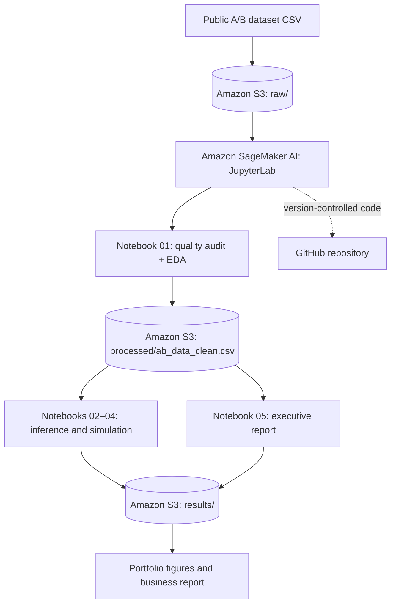

# A/B Testing: Statistical Inference and Business Decision-Making on AWS

  

An end-to-end **data science portfolio project** that evaluates whether a redesigned e-commerce landing page changes customer conversion rates. It combines data-quality audits, statistical inference, bootstrap uncertainty estimation, Monte Carlo simulation, power analysis, and economic impact scenarios, implemented in **Python on Amazon SageMaker AI and Amazon S3**.

> **Evidence status:** The included notebooks are analysis code, not verified experiment results. No observed conversion rates, p-values, confidence intervals, or business conclusions are asserted in this README until the notebooks are executed against the actual data and reviewed.

## Business question

**Does the new landing page improve the conversion rate sufficiently to justify a rollout?** We evaluate both statistical evidence and practical business value rather than treating a p-value as a deployment decision.

- **Control (A):** existing page (`control` / `old_page`).
- **Treatment (B):** redesigned page (`treatment` / `new_page`).
- **Primary metric:** conversion rate (`converted` ∈ {0, 1}).
- **Estimand:** treatment minus control conversion probability, in percentage points.
- **Main test:** two-sided, pooled two-proportion Z-test, nominal α = 0.05.
- **Uncertainty:** 95% Newcombe CI for the absolute rate difference; bootstrap sensitivity check.
- **Practical impact:** absolute lift, relative lift, monthly incremental conversions and contribution margin **under editable hypothetical assumptions**.

## AWS architecture



**Cloud services:** SageMaker AI (CPU JupyterLab), S3, IAM for least-privilege access; CloudWatch for optional monitoring. **No endpoint, GPU, or model-training job is needed.** Storage and running notebook resources can incur AWS charges; shut down JupyterLab spaces/compute explicitly after use.

### S3 object layout

```text
s3://<YOUR_BUCKET>/
├── raw/ab_data.csv
├── processed/ab_data_clean.csv
└── results/
    ├── notebook02/
    ├── notebook03/
    ├── notebook04/
    └── notebook05/
```

Notebook 01 also writes audit summaries under `results/`; notebook 02 writes `results/notebook02_conversion_intervals.csv` and other artifacts under `results/notebook02/`.

## Data and study design

The public Udacity A/B testing dataset (also mirrored on [Kaggle](https://www.kaggle.com/datasets/zhangluyuan/ab-testing)) contains `user_id`, `timestamp`, `group`, `landing_page`, and `converted`. The raw CSV is **not redistributed** in this repository: download it from the original dataset source and upload it to `raw/ab_data.csv`.

| Field | Meaning |
|---|---|
| `user_id` | User identifier |
| `timestamp` | Observation time |
| `group` | Experimental assignment: control or treatment |
| `landing_page` | Observed old/new page |
| `converted` | Binary conversion indicator |

### Quality and causal-inference caveats

1. Identify missingness, duplicated users, group/page mismatches, date coverage, and distribution changes over time.
2. Notebook 01 produces an **analysis-ready, cleaned sample** by excluding mismatched exposure records and retaining one row per user. This is a practical educational choice, **not a guaranteed unbiased intention-to-treat (ITT) estimator**.
3. Check the experimental allocation / sample-ratio mismatch (SRM), using an assumed 50/50 split **only if confirmed by experiment design**; a cleaned-sample SRM check is not a substitute for testing allocation in the original randomized population.
4. Interpret statistical tests as associational unless random assignment, treatment exposure, exclusion rules, independence, and tracking quality are validated.
5. Avoid selective stopping and multiple unplanned hypothesis tests; preregister the primary metric and sample size in a real experiment.

## Statistical methodology

### Hypotheses

For conversion probabilities \(p_A\) and \(p_B\):

- **H0:** \(p_B - p_A = 0\)
- **H1:** \(p_B - p_A \ne 0\)

The two-sided test detects improvement or harm. For the primary inference, the pooled standard error is computed under the null; a **Newcombe 95% CI** estimates the absolute difference without relying on the pooled-null assumption.

### Analysis plan

| Stage | Methods | Deliverables |
|---|---|---|
| 01 — Data quality & EDA | schema checks, deduplication, allocation/exposure consistency, conversion by group and day | cleaned data, audit summaries, plots |
| 02 — Probability & inference | Bernoulli/binomial simulations, sampling distributions, standard errors, Wilson CIs | conversion intervals, explanatory visualizations |
| 03 — Hypothesis testing | two-proportion Z, SRM, Newcombe CI, effect sizes | `hypothesis_test_results.csv`, decision notes |
| 04 — Robustness & planning | within-arm bootstrap, Monte Carlo under H0, Type I/II errors, power, MDE | `statistical_summary.json`, power figures |
| 05 — Business decision | test reconciliation, incremental conversion scenarios, contribution-margin sensitivity | executive report, figures, CSVs, metadata |

### Interpretation standards

- A **p-value** is not the probability that H0 is true.
- **Failure to reject H0** does not establish equal performance or equivalence.
- Confidence intervals quantify sampling uncertainty, not all data-quality or design bias.
- Statistically significant effects may still be economically negligible.
- Post hoc power is not a substitute for prospective sample-size planning.

## Results: pending real execution

The following table is intentionally unpopulated rather than reporting invented measurements.

| Metric | Observed result | Source after execution |
|---|---|---|
| Control users / conversions | Pending | `results/notebook03/hypothesis_test_results.csv` |
| Treatment users / conversions | Pending | same |
| Conversion rates (A / B) | Pending | same |
| Absolute difference (percentage points) | Pending | same |
| Relative lift | Pending | same |
| Two-sided Z statistic and p-value | Pending | same |
| 95% CI for (B − A) | Pending | same |
| SRM p-value | Pending | same |
| Bootstrap CI / Monte Carlo p-value | Pending | `results/notebook04/statistical_summary.json` |
| Business decision | Pending | `results/notebook05/executive_report.md` |

**To publish verified findings:** execute the notebooks against the same input snapshot, inspect the audit and assumptions, then populate this table and link the saved plots. Do not claim causal impact if the cleaned dataset prevents an appropriate ITT analysis.

## Business impact framework

Let \(V\) = eligible monthly visitors, \(\Delta\) = absolute conversion-rate change, \(M\) = contribution margin per conversion, and \(C\) = incremental implementation and operating costs.

- **Expected incremental conversions / month:** \(V \times \Delta\)
- **Expected monthly incremental margin (before additional costs):** \(V \times \Delta \times M\)
- **Net estimated horizon impact:** incremental margin over horizon minus \(C\)

The executive notebook starts with **illustrative assumptions only** (500,000 monthly visitors; MXN 150 margin per conversion; MXN 100,000 implementation; 3 months). These are **not measured business outcomes**. Replace them with actual finance/traffic inputs before making a recommendation; examine pessimistic and optimistic effects from the confidence interval.

**Decision framework:** release only if data quality and experiment validity are acceptable, the estimated improvement is directionally favorable with sufficiently narrow uncertainty, and plausible net benefits exceed rollout costs and risk. Otherwise retain the control, collect more data according to a prespecified plan, or redesign the experiment.

## Repository structure

```text
ab-testing-statistical-analysis/
├── notebooks/
│   ├── 01_EDA_Calidad_Datos_AB_Testing_AWS.ipynb
│   ├── 02_Probabilidad_Inferencia_AB_Testing_AWS.ipynb
│   ├── 03_Pruebas_Hipotesis_AB_Testing_AWS.ipynb
│   ├── 04_Bootstrap_MonteCarlo_Potencia_AB_Testing_AWS.ipynb
│   └── 05_Informe_Ejecutivo_Conclusiones_AB_Testing_AWS.ipynb
├── data/                  # raw and processed data excluded from Git
├── reports/               # optional published, reviewed outputs
├── figures/               # optional reviewed plots
├── scripts/
├── requirements.txt
├── .gitignore
└── README.md
```

Notebook narratives are in Spanish; this README is in English for international portfolio review.

## Reproducibility: Amazon SageMaker AI

1. Create an S3 bucket and upload the source CSV as `raw/ab_data.csv`.
2. Open **SageMaker Studio → JupyterLab** with a CPU instance and an IAM role permitting `s3:GetObject` on the input and `s3:PutObject` on processed/results paths.
3. Clone or upload this repository to the JupyterLab environment.
4. Install dependencies: `pip install -r requirements.txt`.
5. In **each notebook**, set `BUCKET = "<YOUR_BUCKET>"`, `USE_S3 = True` and check `ALPHA` and the intended allocation ratio.
6. Run **01 → 02 → 03 → 04 → 05**, in order. The first notebook writes the cleaned dataset required by the rest.
7. Inspect generated files under S3 `results/`. Read the 05 executive report, verify calculations, then copy reviewed results to this README / `reports/` as appropriate.
8. **Stop the SageMaker compute resources** when finished.

### Local option

- Download `ab_data.csv` to `data/ab_data.csv`; set `USE_S3 = False` in Notebook 01.
- After Notebook 01, copy `outputs/ab_data_clean.csv` to `data/ab_data_clean.csv` for notebooks 02–05 and set `USE_S3 = False` in them.
- Execute notebooks from the repository root. Local outputs follow each notebook's configured `OUTPUT_DIR`.

## Portfolio outcomes

This project demonstrates experiment analysis, statistical test selection, effect-size communication, uncertainty estimation, simulation-based robustness checks, power planning, AWS S3/SageMaker workflows, and translating uncertainty into a business recommendation.

## Limitations and next improvements

- Validate random assignment and perform ITT inference from an appropriate experiment log where possible.
- Add automated schema/unit tests, data lineage, and a pinned environment for stricter reproducibility.
- Extend to sequential tests or multiple-testing corrections only with a predeclared analysis plan.
- Consider guardrail metrics (revenue per visitor, latency, bounce rate) if such data become available.

## Author

Portfolio project by **Julio César Valderrábano Hernández** · [GitHub profile](https://github.com/jcvhrocker-glitch).

## Data acknowledgment

Udacity A/B Testing learning dataset; available via the public Kaggle mirror linked above. Dataset provenance and experimental implementation constraints should be checked before making causal claims.
